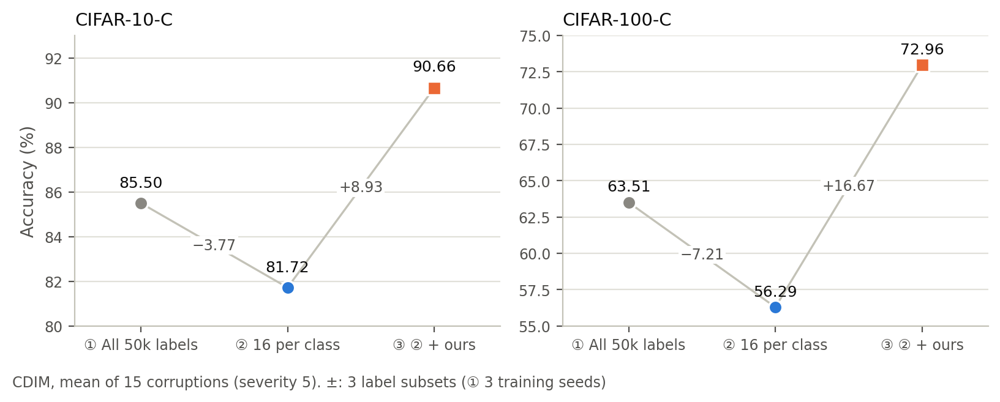

# 라벨이 적을 때의 다중 파운데이션 모델 TTA: Few-shot DINO head + DINO 적응

**Few-shot labels for multi-foundation-model test-time adaptation (CLIP + DINOv2) on corrupted images**

> 클래스당 16장(160장)의 라벨만으로, 5만 장 전부로 학습한 모델보다 손상 이미지에서 더 정확합니다.
> CIFAR-10-C 90.66% vs 85.50% (+5.16%p), CIFAR-100-C 72.96% vs 63.51% (+9.45%p).

English summary. With only 16 labeled images per class, we attach a training-free DINOv2 prototype head to CLIP + CDIM test-time adaptation and also adapt DINOv2's LayerNorm during TTA. On CIFAR-10-C (severity 5, 15 corruptions) this beats a model trained on all 50k labels by +5.16%p, works with 7 different TTA methods, and scales to CIFAR-100-C (+9.45%p) without retuning.


---

## 핵심 결과

1. **라벨 160장으로 5만 장을 넘습니다.** 클래스당 16장만 쓴 ours가 5만 장 전부로 학습한 모델보다 +5.16%p 높습니다(90.66% vs 85.50%).
2. **라벨은 CLIP 학습보다 DINO 쪽에 쓸 때 훨씬 효과가 큽니다.** 같은 160장을 CLIP 미세조정에 쓰면 +1.91%p, Few-shot DINO head + DINO 적응에 쓰면 +10.75%p입니다(라벨 없는 CDIM 79.81% 기준).
3. **두 파운데이션 모델을 함께 적응시키면 효과가 더해지는 것보다 큽니다.** DINO 적응만 +1.02%p, head만 +4.63%p, 둘 다 +8.93%p로 상호작용이 +3.28%p입니다.
4. **어떤 TTA 방법에 붙여도 5만 장 모델을 넘습니다.** 7개 방법(Source, TENT, ETA, SAR, TDA, BATCLIP, CDIM) 모두 +5.16 ~ +15.22%p입니다.
5. **클래스당 2장(총 20장)부터** 라벨 subset 3개 모두 5만 장 모델을 넘습니다(88.27% vs 85.50%).
6. **클래스 100개(CIFAR-100-C)에서는 효과가 더 큽니다.** CIFAR-10 하이퍼파라미터를 그대로 썼는데 +9.45%p(72.96% vs 63.51%), 상호작용은 +6.88%p입니다.

---

## 문제 설정

- **분포 이동:** 5만 장으로 학습한 CLIP 모델은 깨끗한 CIFAR-10 test에서 97.43%지만, 손상 이미지(CIFAR-10-C 15종, severity 5)에서는 73.07%로 떨어집니다.
- **Test-Time Adaptation (TTA):** 테스트 이미지가 들어오는 동안 라벨 없이 모델 일부를 고칩니다. online, 배치 200장, 배치마다 예측 후 1 step 업데이트, 손상 종류가 바뀌면 처음 상태로 돌아갑니다(episodic).
- **다중 파운데이션 모델 TTA:** CDIM은 CLIP과 DINOv2를 함께 쓰는 TTA 방법입니다(연구실 원고 단계).
- **이 프로젝트의 질문:** source 라벨이 **클래스당 16장뿐일 때** 다중 파운데이션 모델 TTA는 어떻게 되는가, 그리고 그 적은 라벨을 어디에 써야 하는가.
- **출발점이 된 관찰:** source 모델 22개를 보면 TTA 후 정확도는 source의 clean 정확도로 거의 정해집니다(R² = 0.88). 같은 16장으로 만든 DINOv2 클래스 프로토타입은 clean 96.05%로, 같은 16장으로 미세조정한 CLIP(94.52%)보다 높았습니다.

## 방법

기존 모델은 **16장으로 미세조정한 CLIP + CDIM**입니다. 여기에 두 가지를 더했습니다(그림에서 분홍색).

1. **Few-shot DINO head:** 라벨 이미지의 DINOv2 특징으로 클래스 프로토타입을 만들고, test 특징과의 코사인 유사도를 logit에 더합니다. 학습할 파라미터가 없습니다.
   - 특징: CLS 토큰 ⊕ patch 평균(1536차원), 중심화(프로토타입은 라벨 평균, test는 지금까지 본 test 특징의 누적 평균을 뺌), test 이미지와 좌우반전 이미지의 평균
2. **DINO 적응:** TTA 중 CLIP뿐 아니라 DINOv2의 LayerNorm도 같은 손실·같은 optimizer로 업데이트합니다. 적응한 DINO 특징은 head에만 쓰고, CDIM의 DINO 분기는 원래 DINO를 그대로 씁니다.

**식** (배치 B = 200, C: CLIP 이미지 특징, D: DINOv2 CLS 특징, W: CLIP 분류기, 모두 정규화)

CDIM (기존 방법)
- 교차공분산 투영: $M = C^\top D / B$, $T_D = \mathrm{normalize}_{\text{col}}(M^\top W^\top)$
- 앙상블 logit: $Z = \tfrac{1}{2}\left(\tau_c^{-1}\, C W^\top + \tau_d^{-1}\, D\, T_D\right)$, $\tau_c^{-1} = 100$, $\tau_d^{-1} = 20$
- Gated Info-Max 손실: 에너지 $E = -\mathrm{logsumexp}(Z)$가 가장 높은 5%를 빼고, $L = \frac{1}{|G|}\sum_{i \in G} H(p_i) - H(\bar p)$
- OLA 예측: $\pi \leftarrow 0.9\,\pi + 0.1\,\bar p$, $\hat y = \arg\max(Z - \log \pi)$

Ours (더한 부분)
- $P = \lambda\, \tau_p^{-1}\, q\, P_{\text{proto}}^\top$ ($\lambda = 1$, $\tau_p^{-1} = 50$, $q$: 적응한 DINOv2의 test 특징)
- $Z_{\text{ours}} = Z + \tfrac{1}{2} P$. 손실과 OLA 예측은 $Z_{\text{ours}}$로 계산
- $L$의 gradient로 CLIP 이미지 인코더 LayerNorm과 adapted DINOv2 LayerNorm을 함께 업데이트

| 부분 | 오프라인 (라벨 160장) | TTA 중 (라벨 없음) |
|---|---|---|
| CLIP 이미지 인코더 LayerNorm | 미세조정 | 업데이트 |
| CLIP 분류기 W (텍스트로 초기화) | 미세조정 | 고정 |
| DINOv2 (source, CDIM 분기) | 고정 | 고정 |
| DINOv2 (adapted, head용) | 고정 | **LayerNorm 업데이트** |
| 프로토타입 | 클래스 평균 (gradient 없음) | 고정 |

## 실험 설정

- **모델:** OpenAI CLIP ViT-B/16(프롬프트 `a photo of a {class}.`), DINOv2 ViT-B/14
- **데이터:** source는 CIFAR-10 train에서 클래스당 16장(라벨 subset 3개, seed 0·1·2). target은 CIFAR-10-C severity 5, 15종 × 10,000장. 32×32를 224×224로 PIL bicubic 리사이즈(CLIP 공식 전처리)
- **CLIP 미세조정:** 이미지 LayerNorm + 분류기, AdamW lr 1e-4, batch 128, 782 iteration(16장) / 10 epoch(5만 장)
- **TTA:** online batch 200, AdamW lr 1e-3, 손상마다 초기화. 모든 방법이 같은 프로토콜과 같은 test 순서
- **선택 규칙:** λ, head 구성, DINO 적응 방식은 탐색용 손상 4종(Gaussian, Defocus, Snow, Contrast)으로만 골랐습니다. DINO 적응의 이득은 탐색에 안 쓴 11종에서 +4.32%p로, 탐색용 4종(+4.26%p)과 같습니다.
- **환경:** NVIDIA V100 32GB 1장. 손상 1종(10,000장) TTA에 CDIM 34초 / ours 81초, 메모리 13.8GB / 25.7GB

## 결과 (CDIM, severity 5, 15종 평균, ±는 3회 표준편차)

### Table A: 5만 장 → 16장 → 16장 + ours (CIFAR-10-C)

| 조건 | 라벨 | Noise | Blur | Weather | Digital | **평균** | vs ① |
|---|---|---|---|---|---|---|---|
| ① 5만 장 전부로 학습 | 50,000 | 77.29 | 85.96 | 92.49 | 84.20 | 85.50 ±0.01 | – |
| ② 16장으로 학습 | 160 | 73.29 | 81.72 | 89.61 | 80.16 | 81.72 ±0.20 | −3.77 |
| **③ ② + ours** | 160 | **87.16** | **90.30** | **94.38** | **89.91** | **90.66 ±0.26** | **+5.16** |
| (참고) 라벨 없음 | 0 | 71.53 | 79.52 | 87.86 | 78.28 | 79.81 | −5.68 |
| (참고) CLIP 학습 없이 ours | 160 | 87.08 | 90.12 | 94.38 | 89.79 | 90.56 ±0.27 | +5.06 |
| (참고) 같은 방식을 5만 장에 (상한) | 50,000 | 87.92 | 91.11 | 95.27 | 90.85 | 91.51 ±0.02 | +6.01 |

- ③은 라벨 subset 3개 모두, 손상 15종 모두에서 ①보다 높습니다.

### 같은 160장을 쓰는 방법과의 비교 (CIFAR-10-C)

| 방법 | 평균 |
|---|---|
| CDIM (라벨 없음) | 79.81 |
| CDIM + CLIP 미세조정 (②) | 81.72 ±0.20 |
| CDIM + CLIP 미세조정 + DINO 적응 (head 없음) | 82.74 ±0.23 |
| CDIM + Tip-Adapter (CLIP 캐시) | 80.71 ±0.07 |
| CDIM + DINO 캐시 (Tip 방식, 가장 강한 baseline) | 85.60 ±0.11 |
| **ours** | **90.66 ±0.26** |

Tip 계열의 α·β는 ours의 λ와 같은 규칙(탐색용 4종, TTA 없음)으로 골랐습니다.

### Ablation (2×2, ② = 81.72 기준)

| ②에 더한 것 | 평균 | ② 대비 |
|---|---|---|
| DINO 적응만 | 82.74 | +1.02 |
| Few-shot DINO head만 | 86.35 | +4.63 |
| **둘 다 (ours)** | **90.66** | **+8.93** |

상호작용 +3.28%p. head는 DINO 특징 공간에서 프로토타입과 비교하므로, 손상으로 틀어진 DINO 특징을 test 분포에 맞추면 head가 다시 잘 작동합니다.

### 다른 TTA 방법에 붙이기 (CIFAR-10-C)

| TTA 방법 | ① 5만 장 | ② 16장 | ③ ② + ours | ③ − ① |
|---|---|---|---|---|
| Source (TTA 없음) | 73.07 | 66.73 | 82.05 | +8.98 |
| TENT | 71.62 | 68.12 | 86.84 | +15.22 |
| ETA | 84.02 | 80.25 | 89.43 | +5.41 |
| SAR | 75.29 | 71.75 | 82.48 | +7.19 |
| TDA | 73.28 | 67.19 | 82.10 | +8.82 |
| BATCLIP | 80.86 | 76.57 | 88.50 | +7.64 |
| **CDIM** | **85.50** | **81.72** | **90.66** | **+5.16** |

### 라벨 수 곡선 (CIFAR-10-C)


| 클래스당 라벨 | 1 | 2 | 4 | 8 | **16** | 79 | 157 | 625 | 5000 |
|---|---|---|---|---|---|---|---|---|---|
| baseline (CLIP 미세조정 + CDIM) | 79.91 | 80.45 | 80.73 | 81.49 | **81.72** | 82.63 | 83.05 | 83.58 | 85.50 |
| **ours** | 84.76 | 88.27 | 89.17 | 90.16 | **90.66** | 91.09 | 91.15 | 91.23 | 91.51 |

### CIFAR-100-C (클래스 100개, 하이퍼파라미터 재조정 없음)



| 조건 | CIFAR-10-C | CIFAR-100-C |
|---|---|---|
| 라벨 없음 (zero-shot CLIP) | 79.81 | 51.80 |
| ① 5만 장 | 85.50 | 63.51 |
| ② 16장 (CIFAR-100은 1,600장) | 81.72 | 56.29 |
| **③ ② + ours** | **90.66** | **72.96** |
| **③ − ①** | **+5.16** | **+9.45** |

CIFAR-100-C 2×2 (② 기준): DINO 적응만 +0.56, head만 +9.23, 둘 다 +16.67, 상호작용 +6.88.

더 자세한 표는 [`results/`](results/)에 있습니다(`analyze.py`, `sum_c100.py`가 만든 표 그대로).

---

## 코드 구성

```
config.py          실험 조건과 stage(실행 단위) 정의. 조건은 여기서만 바꿈
main.py            실행: check / sanity / kshot --stage <이름>
core/
  data.py          CIFAR-10(-C)·CIFAR-100(-C) 로드, 라벨 subset 추출, test 스트림 순서
  models.py        CLIP 분류기(텍스트 초기화), DINOv2 로드
  source.py        CLIP 미세조정(LayerNorm + 분류기)과 체크포인트
  methods.py       TTA 방법(Source, TENT, ETA, SAR, TDA, BATCLIP, CDIM), Few-shot DINO head, DINO 적응
  runner.py        run 실행과 결과 CSV 기록(끊겨도 이어서 실행), continual 프로토콜
  runtime.py       GPU·AMP 설정
analyze.py         CIFAR-10 표와 라벨 수 곡선(fig7)
sum_c100.py        CIFAR-100 표와 fig8
sum_ext.py         추가 실험(severity 3, continual) 표
fig_model.py       모델 구조도(fig6, 실제 예측 포함)
make_figs.py       analyze.py + fig_model.py
make_data_figures.py  데이터 그림(fig1~fig5)
prepare_data.py    데이터·가중치 다운로드
diag_tip.py        Tip 계열 baseline의 α·β 선택 (diag_dino.py 함수 사용)
pick_ours.py       head 구성 선택 기록
smoke_cont.py      continual 경로 점검
```

## 실행 방법

**환경** (V100 기준. PyTorch는 CUDA 빌드에 맞춰 설치)
```bash
conda create -n cdim python=3.10 -y && conda activate cdim
pip install torch==2.6.0 torchvision==0.21.0 --index-url https://download.pytorch.org/whl/cu118
pip install -r requirements.txt
pip install --no-deps https://github.com/openai/CLIP/archive/refs/heads/main.zip
```

**데이터·가중치** (`~/cdim_data`에 저장, 약 4GB + CIFAR-100-C)
```bash
python prepare_data.py                      # CIFAR-10, CIFAR-10-C, CLIP, DINOv2
python prepare_data.py --dataset cifar100   # CIFAR-100, CIFAR-100-C
```

**실행** (GPU 1장만 보이게 해야 실행됩니다)
```bash
export CUDA_VISIBLE_DEVICES=0
python main.py check                         # 환경 점검 (zero-shot 약 90%면 정상)
python main.py kshot --stage Q15_dlnh        # 예: ③ ours, 15종, subset 3개
python main.py kshot --stage Q15_dlnh --plan # 남은 run과 예상 시간만 출력
python analyze.py                            # 표·그림 (GPU 불필요)
```
- 결과는 run마다 `experiments/<EXP_NAME>/results_kshot*.csv`에 한 줄씩 쌓입니다. 같은 설정은 어느 stage에서 돌았든 한 번만 돕니다.
- CIFAR-100은 `DATASET=cifar100`, 추가 실험은 `SEVERITY=3` 또는 `PROTOCOL=continual` 환경 변수로 고릅니다. 결과 폴더가 따로 생깁니다.

**주요 표의 stage** (CIFAR-10. stage 정의는 `config.py`)

| 표의 행 | stage |
|---|---|
| ① 5만 장 (10 epoch, 학습 seed 3개) | `K_full_ep10`, `K_full_rep_s1`, `K_full_rep_s2` |
| ② 16장 CLIP 미세조정 + CDIM | `L_p5` |
| ③ ours | `Q15_dlnh` |
| head만 / DINO 적응만 / CLIP 학습 없이 ours / 상한 | `N_head15_b` / `R_nohead` / `R_zs` / `R_full` |
| 라벨 수 곡선 (baseline / ours) | `L_curve_base_a`, `L_curve_base_b` / `R_curve_a`, `R_curve_b` |
| 다른 TTA 방법 (② / ③) | `M_ft` / `R_tta` |
| Tip-Adapter·DINO 캐시 | `diag_tip.py` → `G_fewshot_tuned`, `G_tta_tip` |
| CIFAR-100-C (`DATASET=cifar100`) | `X_zs`, `X_base16`, `X_basefull`, `X_basetta`, `X_ours16`, `X_oursfull`, `X_ourstta_a`, `X_ourstta_b` |

## 주의

- 모든 비교는 같은 구현·같은 프로토콜 안의 상대 비교입니다.
- CDIM은 연구실 원고 단계의 방법입니다(manuscript in preparation). 이 저장소의 CDIM 수치는 모두 직접 돌린 값입니다. 우리 기여는 CDIM 위에 더한 Few-shot DINO head와 DINO 적응입니다.
- ETA·SAR·TDA는 같은 프로토콜에 맞춘 재구현입니다. ETA는 Fisher 정규화가 없고, SAR은 AdamW를 쓰고, TDA는 positive cache만 씁니다. SAR은 이 설정에서 붕괴 감지로 거의 매 배치 초기화돼 사실상 TTA가 없는 값입니다.
- 클래스당 1장은 라벨 subset에 따라 크게 흔들립니다(84.76 ±2.43).
- ours는 TTA 시간이 CDIM의 약 2.3배, 메모리가 약 1.9배입니다.

## 참고문헌

- CLIP: Radford et al., ICML 2021 / DINOv2: Oquab et al., 2023
- CIFAR-10-C: Hendrycks & Dietterich, ICLR 2019
- TENT: Wang et al., ICLR 2021 / EATA·ETA: Niu et al., ICML 2022 / SAR: Niu et al., ICLR 2023 / TDA: Karmanov et al., CVPR 2024 / BATCLIP
- Tip-Adapter: Zhang et al., ECCV 2022 / CaFo: Zhang et al., CVPR 2023 / Prototypical Networks: Snell et al., NeurIPS 2017
- CDIM: manuscript in preparation
