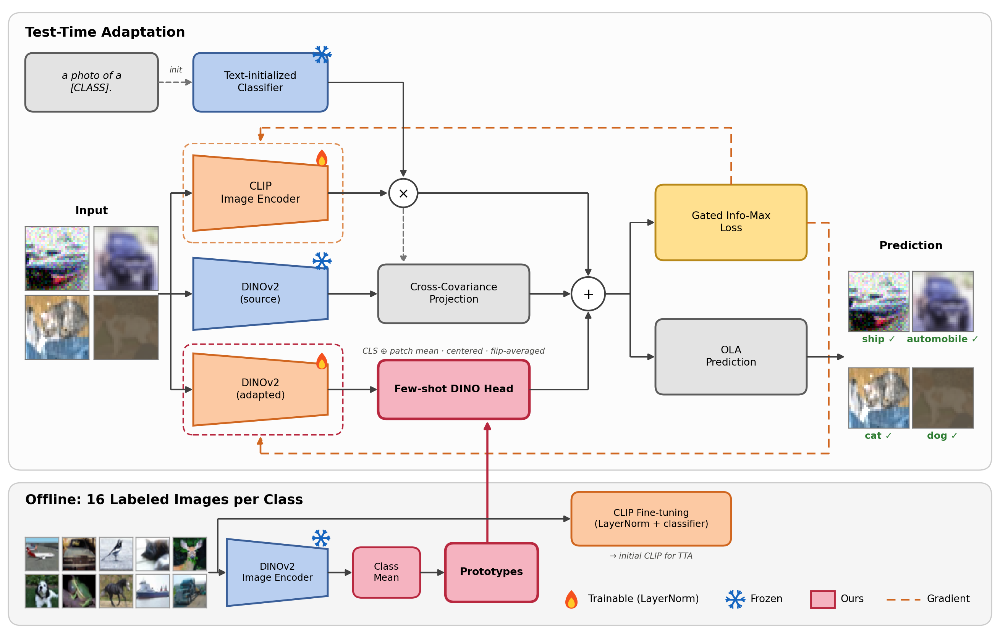
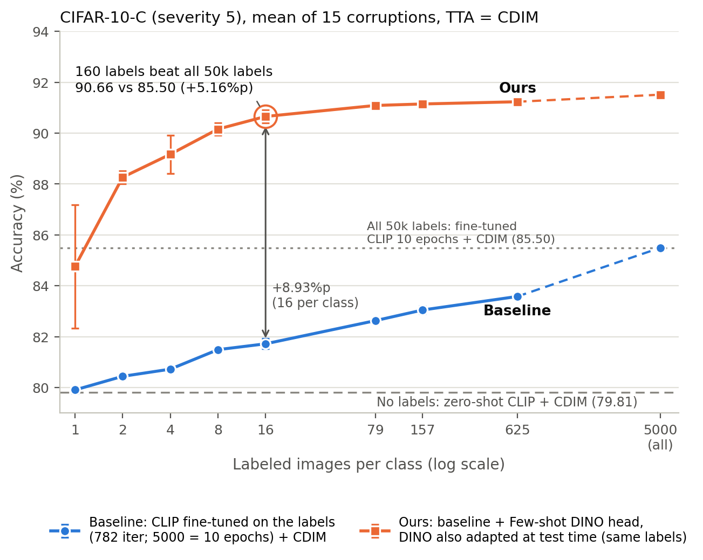

# 라벨이 적을 때의 다중 파운데이션 모델 TTA: Few-shot DINO head + DINO 적응

**Few-shot labels for multi-foundation-model test-time adaptation (CLIP + DINOv2) on corrupted images**

> 클래스당 16장(160장)의 라벨만으로, 5만 장 전부로 학습한 모델보다 손상 이미지에서 더 정확합니다.
> CIFAR-10-C 90.66% vs 85.50% (+5.16%p), CIFAR-100-C 72.96% vs 63.51% (+9.45%p).

English summary. With only 16 labeled images per class, we attach a training-free DINOv2 prototype head to CLIP + CDIM test-time adaptation and also adapt DINOv2's LayerNorm during TTA. On CIFAR-10-C (severity 5, 15 corruptions) this beats a model trained on all 50k labels by +5.16%p, works with 7 different TTA methods, and scales to CIFAR-100-C (+9.45%p) without retuning.



---

## 핵심 결과

1. **라벨 160장으로 5만 장을 넘습니다.** 클래스당 16장만 쓴 ours가 5만 장 전부로 학습한 모델보다 +5.16%p 높습니다(90.66% vs 85.50%).
2. **라벨은 CLIP 학습보다 DINO 쪽에 쓸 때 훨씬 효과가 큽니다.** 같은 160장을 CLIP 미세조정에 쓰면 +1.91%p, Few-shot DINO head + DINO 적응에 쓰면 +10.75%p입니다(라벨 없는 CDIM 79.81% 기준).
3. **두 파운데이션 모델을 함께 적응시키면 효과가 더해지는 것보다 큽니다.** DINO 적응만 +1.02%p, head만 +4.63%p, 둘 다 +8.93%p로 상호작용이 +3.28%p입니다.
4. **어떤 TTA 방법에 붙여도 5만 장 모델을 넘습니다.** 7개 방법(Source, TENT, ETA, SAR, TDA, BATCLIP, CDIM) 모두 +5.16 ~ +15.22%p입니다.
5. **클래스당 2장(총 20장)부터** 라벨 subset 3개 모두 5만 장 모델을 넘습니다(88.27% vs 85.50%).
6. **클래스 100개(CIFAR-100-C)에서는 효과가 더 큽니다.** CIFAR-10 하이퍼파라미터를 그대로 썼는데 5만 장 모델보다 +9.45%p(72.96% vs 63.51%), 같은 라벨을 쓰는 가장 강한 baseline보다 +9.79%p 높고, 상호작용은 +6.88%p입니다.
7. **약한 손상과 continual TTA에서도 성립합니다.** severity 3에서 5만 장 모델보다 +3.24%p, 손상 15종을 리셋 없이 이어서 적응하는 continual에서는 +7.72%p 높고, DINO 적응이 긴 스트림에서도 무너지지 않습니다.

---

## 문제 설정

- **분포 이동:** 5만 장으로 학습한 CLIP 모델은 깨끗한 CIFAR-10 test에서 97.43%지만, 손상 이미지(CIFAR-10-C 15종, severity 5)에서는 73.07%로 떨어집니다.
- **Test-Time Adaptation (TTA):** 테스트 이미지가 들어오는 동안 라벨 없이 모델 일부를 고칩니다. online, 배치 200장, 배치마다 예측 후 1 step 업데이트, 손상 종류가 바뀌면 처음 상태로 돌아갑니다(episodic).
- **다중 파운데이션 모델 TTA:** CDIM은 CLIP과 DINOv2를 함께 쓰는 TTA 방법입니다([Kim et al., arXiv 2026](https://arxiv.org/abs/2611.04489)).
- **이 프로젝트의 질문:** source 라벨이 **클래스당 16장뿐일 때** 다중 파운데이션 모델 TTA는 어떻게 되는가, 그리고 그 적은 라벨을 어디에 써야 하는가.
- **출발점이 된 관찰:** source 모델 22개를 보면 TTA 후 정확도는 source의 clean 정확도로 거의 정해집니다(R² = 0.88). 같은 16장으로 만든 DINOv2 클래스 프로토타입은 clean 96.05%로, 같은 16장으로 미세조정한 CLIP(94.52%)보다 높았습니다.

## 방법

기존 모델은 **16장으로 미세조정한 CLIP + CDIM**입니다. 여기에 두 가지를 더했습니다(그림에서 분홍색).

1. **Few-shot DINO head:** 라벨 이미지의 DINOv2 특징으로 클래스 프로토타입을 만들고, test 특징과의 코사인 유사도를 logit에 더합니다. 학습할 파라미터가 없습니다.
   - 특징: CLS 토큰 ⊕ patch 평균(1536차원), 중심화(프로토타입은 라벨 평균, test는 지금까지 본 test 특징의 누적 평균을 뺌), test 이미지와 좌우반전 이미지의 평균
2. **DINO 적응:** TTA 중 CLIP뿐 아니라 DINOv2의 LayerNorm도 같은 손실·같은 optimizer로 업데이트합니다. 적응한 DINO 특징은 head에만 쓰고, CDIM의 DINO 분기는 원래 DINO를 그대로 씁니다.

**식** (배치 B = 200, C: CLIP 이미지 특징, D: DINOv2 CLS 특징, W: CLIP 분류기, 모두 정규화)

CDIM (기존 방법, Kim et al., 2026. 식과 하이퍼파라미터는 논문과 같음)
- 교차공분산 투영: $M = C^\top D / B$, $T_D = \mathrm{normalize}_{\text{col}}(M^\top W^\top)$
- 앙상블 logit: $Z = \tfrac{1}{2}\left(\tau_c^{-1}\, C W^\top + \tau_d^{-1}\, D\, T_D\right)$, $\tau_c^{-1} = 100$, $\tau_d^{-1} = 20$
- Gated Info-Max 손실: 에너지 $E = -\mathrm{logsumexp}(Z)$가 가장 높은 5%를 빼고, $L = \frac{1}{|G|}\sum_{i \in G} H(p_i) - H(\bar p)$
- OLA 예측: $\pi \leftarrow 0.9\,\pi + 0.1\,\bar p$, $\hat y = \arg\max(Z - \log \pi)$

Ours (더한 부분)
- $P = \lambda\, \tau_p^{-1}\, q\, P_{\text{proto}}^\top$ ($\lambda = 1$, $\tau_p^{-1} = 50$, $q$: 적응한 DINOv2의 test 특징)
- $Z_{\text{ours}} = Z + \tfrac{1}{2} P$. 손실과 OLA 예측은 $Z_{\text{ours}}$로 계산
- $L$의 gradient로 CLIP 이미지 인코더 LayerNorm과 adapted DINOv2 LayerNorm을 함께 업데이트

| 부분 | 오프라인 (라벨 160장) | TTA 중 (라벨 없음) |
|---|---|---|
| CLIP 이미지 인코더 LayerNorm | 미세조정 | 업데이트 |
| CLIP 분류기 W (텍스트로 초기화) | 미세조정 | 고정 |
| DINOv2 (source, CDIM 분기) | 고정 | 고정 |
| DINOv2 (adapted, head용) | 고정 | **LayerNorm 업데이트** |
| 프로토타입 | 클래스 평균 (gradient 없음) | 고정 |

## 실험 설정

- **모델:** OpenAI CLIP ViT-B/16(프롬프트 `a photo of a {class}.`), DINOv2 ViT-B/14
- **데이터:** source는 CIFAR-10 train에서 클래스당 16장(라벨 subset 3개, seed 0·1·2). target은 CIFAR-10-C severity 5, 15종 × 10,000장. 32×32를 224×224로 PIL bicubic 리사이즈(CLIP 공식 전처리). CIFAR-100(-C)도 같은 방식이고(클래스당 16장 = 1,600장), 하이퍼파라미터는 CIFAR-10 값을 그대로 씁니다.
- **CLIP 미세조정:** 이미지 LayerNorm + 분류기, AdamW lr 1e-4, batch 128, 782 iteration(16장) / 10 epoch(5만 장)
- **TTA:** online batch 200, AdamW lr 1e-3, 손상마다 초기화. 모든 방법이 같은 프로토콜과 같은 test 순서
- **선택 규칙:** λ, head 구성, DINO 적응 방식은 탐색용 손상 4종(Gaussian, Defocus, Snow, Contrast)으로만 골랐습니다. DINO 적응의 이득은 탐색에 안 쓴 11종에서 +4.32%p로, 탐색용 4종(+4.26%p)과 같습니다.
- **환경:** NVIDIA V100 32GB 1장. 손상 1종(10,000장) TTA에 CDIM 34초 / ours 81초, 메모리 13.8GB / 25.7GB

## 결과 (severity 5, 손상 15종, 정확도 %)

**Table 1. 손상 이미지 online TTA 정확도 (CLIP ViT-B/16).**
- 라벨 없음: 논문과 같은 zero-shot 설정입니다.
- 5만 장 학습: train 전체로 CLIP을 미세조정한 모델이고, 학습 seed 3개의 평균입니다.
- Ours: 클래스당 16장만 쓰고, 라벨 subset 3개의 평균입니다.

**(a) CIFAR-10-C**

| 라벨 | Method | Venue | Gauss. | Shot | Impul. | Defoc. | Glass | Motion | Zoom | Snow | Frost | Fog | Brit. | Contr. | Elastic | Pixel. | JPEG | Mean |
|---|---|---|---|---|---|---|---|---|---|---|---|---|---|---|---|---|---|---|
| 없음 (zero-shot) | CLIP | ICML'21 | 37.95 | 41.69 | 54.43 | 71.69 | 40.86 | 67.94 | 73.64 | 73.93 | 77.41 | 70.32 | 84.45 | 62.31 | 53.78 | 47.60 | 59.46 | 61.16 |
| | TENT | ICLR'21 | 14.85 | 17.53 | 40.53 | 80.50 | 21.52 | 76.45 | 81.18 | 84.46 | 83.63 | 81.55 | 91.61 | 79.31 | 57.61 | 63.52 | 53.40 | 61.84 |
| | ETA | ICML'22 | 63.48 | 66.67 | 72.77 | 82.20 | 59.30 | 81.34 | 82.96 | 85.38 | 86.00 | 83.63 | 91.55 | 83.22 | 71.19 | 75.47 | 71.06 | 77.08 |
| | SAR | ICLR'23 | 32.09 | 39.84 | 63.65 | 79.06 | 41.19 | 79.64 | 80.27 | 83.30 | 84.01 | 80.63 | 90.11 | 78.84 | 66.28 | 72.87 | 67.17 | 69.26 |
| | TDA | CVPR'24 | 38.78 | 42.30 | 55.16 | 72.97 | 42.92 | 69.51 | 75.03 | 74.50 | 77.68 | 70.24 | 84.89 | 63.69 | 55.58 | 50.24 | 59.85 | 62.22 |
| | BATCLIP | ICCV'25 | 59.35 | 62.46 | 65.15 | 79.87 | 50.77 | 80.62 | 81.92 | 82.73 | 83.57 | 81.29 | 88.72 | 81.52 | 67.96 | 58.08 | 67.47 | 72.77 |
| | CDIM | arXiv'26 | 67.41 | 70.33 | 76.84 | 83.26 | 67.21 | 82.65 | 84.96 | 86.56 | 86.86 | 85.43 | 92.57 | 86.64 | 74.75 | 78.47 | 73.26 | 79.81 |
| 5만 장 학습 | Source | ICML'21 | 46.28 | 52.04 | 66.32 | 87.35 | 51.33 | 79.77 | 87.32 | 89.55 | 86.12 | 85.16 | 94.94 | 75.33 | 68.54 | 57.02 | 69.01 | 73.07 |
| | TENT | ICLR'21 | 17.88 | 31.28 | 46.33 | 87.98 | 34.05 | 85.10 | 89.91 | 90.29 | 90.15 | 89.67 | 95.15 | 89.36 | 79.40 | 76.94 | 70.80 | 71.62 |
| | ETA | ICML'22 | 70.13 | 73.36 | 80.83 | 89.54 | 69.33 | 87.94 | 90.87 | 91.49 | 90.38 | 90.82 | 95.53 | 91.22 | 80.36 | 82.09 | 76.46 | 84.02 |
| | SAR | ICLR'23 | 42.11 | 55.86 | 68.12 | 87.35 | 48.60 | 82.37 | 87.33 | 89.55 | 86.12 | 85.18 | 94.94 | 77.87 | 76.67 | 73.83 | 73.46 | 75.29 |
| | TDA | CVPR'24 | 46.89 | 52.20 | 66.76 | 87.42 | 53.22 | 79.95 | 87.43 | 89.36 | 86.00 | 84.66 | 94.96 | 75.67 | 68.84 | 57.14 | 68.72 | 73.28 |
| | BATCLIP | ICCV'25 | 67.70 | 70.89 | 73.97 | 87.13 | 62.52 | 85.92 | 88.44 | 88.31 | 88.33 | 87.57 | 93.42 | 88.31 | 77.50 | 79.83 | 73.12 | 80.86 |
| | CDIM | arXiv'26 | 73.58 | 75.47 | 82.82 | 89.96 | 73.43 | 88.87 | 91.58 | 91.92 | 91.06 | 91.26 | 95.71 | 91.66 | 81.68 | 84.25 | 79.21 | 85.50 |
| **16장/클래스** | **Ours** | | **84.23** | **85.42** | **91.83** | **93.63** | **81.83** | **91.52** | **94.24** | **94.34** | **93.59** | **92.52** | **97.04** | **96.34** | **85.34** | **90.17** | **87.79** | **90.66** |

**(b) CIFAR-100-C**

| 라벨 | Method | Venue | Gauss. | Shot | Impul. | Defoc. | Glass | Motion | Zoom | Snow | Frost | Fog | Brit. | Contr. | Elastic | Pixel. | JPEG | Mean |
|---|---|---|---|---|---|---|---|---|---|---|---|---|---|---|---|---|---|---|
| 없음 (zero-shot) | CLIP | ICML'21 | 19.56 | 21.42 | 25.29 | 42.46 | 20.00 | 43.13 | 47.95 | 48.48 | 49.72 | 41.66 | 57.05 | 34.50 | 29.20 | 23.95 | 32.51 | 35.79 |
| | TENT | ICLR'21 | 5.83 | 8.23 | 9.51 | 52.30 | 6.86 | 52.13 | 55.59 | 54.38 | 36.06 | 51.76 | 65.47 | 54.74 | 36.98 | 44.06 | 37.13 | 38.07 |
| | ETA | ICML'22 | 32.30 | 33.70 | 41.78 | 51.20 | 27.04 | 52.40 | 55.07 | 56.25 | 55.21 | 53.01 | 65.90 | 54.09 | 38.99 | 44.20 | 41.14 | 46.82 |
| | SAR | ICLR'23 | 31.16 | 29.10 | 27.57 | 50.56 | 27.14 | 51.78 | 54.83 | 55.74 | 50.51 | 52.57 | 65.59 | 53.50 | 39.03 | 44.11 | 41.10 | 44.95 |
| | TDA | CVPR'24 | 21.63 | 22.87 | 27.47 | 43.86 | 21.20 | 43.69 | 49.08 | 48.69 | 50.79 | 42.05 | 57.90 | 35.60 | 29.81 | 26.13 | 32.90 | 36.91 |
| | BATCLIP | ICCV'25 | 14.02 | 21.52 | 27.29 | 48.29 | 23.98 | 46.59 | 53.08 | 49.43 | 47.69 | 47.42 | 62.24 | 44.08 | 33.43 | 32.40 | 33.32 | 38.99 |
| | CDIM | arXiv'26 | 37.64 | 39.69 | 46.74 | 56.35 | 37.18 | 56.20 | 60.34 | 59.81 | 58.82 | 56.98 | 69.68 | 59.52 | 44.39 | 49.17 | 44.48 | 51.80 |
| 5만 장 학습 | Source | ICML'21 | 28.51 | 30.16 | 41.24 | 64.72 | 22.81 | 57.33 | 66.63 | 65.62 | 61.95 | 55.80 | 78.86 | 50.10 | 38.54 | 27.72 | 42.08 | 48.81 |
| | TENT | ICLR'21 | 8.57 | 11.66 | 31.98 | 68.67 | 3.55 | 67.34 | 70.62 | 70.20 | 64.83 | 20.80 | 80.74 | 52.78 | 5.24 | 56.80 | 49.54 | 44.22 |
| | ETA | ICML'22 | 40.83 | 44.04 | 55.45 | 68.74 | 29.52 | 67.67 | 70.34 | 70.33 | 67.69 | 67.10 | 80.80 | 70.53 | 52.51 | 59.72 | 52.41 | 59.84 |
| | SAR | ICLR'23 | 24.00 | 24.13 | 54.52 | 68.84 | 6.73 | 67.41 | 70.48 | 70.21 | 66.64 | 38.81 | 80.78 | 68.23 | 16.80 | 58.42 | 49.66 | 51.04 |
| | TDA | CVPR'24 | 28.60 | 30.84 | 41.95 | 65.07 | 24.02 | 57.62 | 66.84 | 65.80 | 62.08 | 55.86 | 78.91 | 50.64 | 39.66 | 29.08 | 42.17 | 49.28 |
| | BATCLIP | ICCV'25 | 35.60 | 37.78 | 46.96 | 63.07 | 31.54 | 59.81 | 64.30 | 61.14 | 60.06 | 59.35 | 73.89 | 61.81 | 45.12 | 47.62 | 41.55 | 52.64 |
| | CDIM | arXiv'26 | 48.16 | 50.20 | 58.17 | 69.76 | 47.41 | 68.78 | 72.00 | 70.91 | 70.13 | 68.94 | 81.12 | 72.43 | 56.99 | 62.20 | 55.40 | 63.51 |
| **16장/클래스** | **Ours** | | **62.76** | **64.70** | **74.62** | **76.67** | **58.15** | **74.21** | **79.44** | **78.63** | **78.05** | **75.66** | **86.05** | **82.92** | **63.41** | **71.29** | **67.87** | **72.96** |

- Ours는 라벨을 클래스당 16장만 쓰는데도(CIFAR-10 0.32%, CIFAR-100 3.2%), 라벨 없는 방법뿐 아니라 5만 장 전부로 학습한 모델에 각 TTA를 붙인 것보다도 높습니다.
- 가장 강한 비교 대상(5만 장 + CDIM)보다 CIFAR-10-C +5.16, CIFAR-100-C +9.45%p 높습니다. 두 데이터셋 모두 손상 15종 각각에서 가장 높습니다.
- Ours의 표준편차는 CIFAR-10-C ±0.26, CIFAR-100-C ±0.09입니다(라벨 subset 3개).

**Table 2. Ablation — 구성 요소별 효과** (모두 CDIM 위, 15종 평균)

| CLIP 미세조정 (16장/클래스) | Few-shot DINO head | DINO 적응 | CIFAR-10-C | CIFAR-100-C |
|---|---|---|---|---|
| | | | 79.81 | 51.80 |
| ✓ | | | 81.72 | 56.29 |
| | | ✓ | 81.36 | 52.68 |
| ✓ | | ✓ | 82.74 | 56.85 |
| ✓ | ✓ | | 86.35 | 65.52 |
| | ✓ | ✓ | 90.56 | 72.45 |
| ✓ | ✓ | ✓ | **90.66** | **72.96** |

- 효과가 가장 큰 것은 Few-shot DINO head입니다(CLIP 미세조정 위에서 +4.63 / +9.23).
- DINO 적응은 head가 없으면 +1.02 / +0.56에 그치지만, head와 함께 쓰면 +4.30 / +7.44를 더합니다. 두 모듈의 상호작용은 +3.28 / +6.88%p입니다. head는 DINO 특징 공간에서 프로토타입과 비교하므로, 손상으로 틀어진 DINO 특징을 test 분포에 맞추면 head가 다시 잘 작동합니다.
- CLIP 미세조정은 head + DINO 적응 위에서 +0.10 / +0.51로 작습니다. 라벨의 효과는 거의 모두 DINO 쪽에서 옵니다.

**Table 3. 라벨을 줄이면 얼마나 떨어지고, 무엇으로 얼마나 오르나** (CDIM, 15종 평균)

| 단계 | CIFAR-10-C | 바로 앞 대비 | CIFAR-100-C | 바로 앞 대비 |
|---|---|---|---|---|
| ① CLIP을 5만 장으로 미세조정 | 85.50 | – | 63.51 | – |
| ② 라벨을 클래스당 16장으로 줄임 | 81.72 | **−3.77** | 56.29 | **−7.21** |
| ② + Few-shot DINO head | 86.35 | **+4.63** | 65.52 | **+9.23** |
| ② + Few-shot DINO head + DINO 적응 = **Ours** | **90.66** | **+4.30** | **72.96** | **+7.44** |
| Ours − ① | **+5.16** | | **+9.45** | |


**Table 4. 같은 라벨(클래스당 16장) baseline과 채택하지 않은 변형** (Main에서 분리, 15종 평균, ± = 라벨 subset 3개)

| 분류 | 방법 | CIFAR-10-C | Ours − 이 방법 | CIFAR-100-C | Ours − 이 방법 |
|---|---|---|---|---|---|
| TTA 없음 | CLIP 미세조정 | 66.73 ±0.98 | +23.93 | 41.62 ±0.31 | +31.34 |
| TTA 없음 | Tip-Adapter (CLIP 캐시) | 63.41 ±0.24 | +27.25 | 36.99 ±0.24 | +35.97 |
| TTA 없음 | DINO 캐시 (Tip 방식) | 79.37 ±0.46 | +11.28 | 55.32 ±0.33 | +17.64 |
| CDIM | CDIM + CLIP 미세조정 | 81.72 ±0.20 | +8.93 | 56.29 ±0.10 | +16.67 |
| CDIM | CDIM + Tip-Adapter | 80.71 ±0.07 | +9.95 | 52.95 ±0.04 | +20.01 |
| CDIM | CDIM + DINO 캐시 (Tip 방식) | 85.60 ±0.11 | +5.05 | 63.17 ±0.10 | +9.79 |
| 채택 안 한 변형 | CDIM + DINO 적응 (head 없음, 라벨 없음) | 81.36 | +9.29 | 52.68 | +20.28 |
| 채택 안 한 변형 | CDIM + CLIP 미세조정 + DINO 적응 (head 없음) | 82.74 ±0.23 | +7.91 | 56.85 ±0.07 | +16.11 |
| 채택 안 한 변형 | 적응한 DINO를 CDIM 분기에도 (dln) | 90.64 ±0.27 | +0.01 | – | |

- Tip 계열의 α·β는 ours의 λ와 같은 규칙(탐색용 4종, TTA 없음)으로 데이터셋마다 골랐습니다. ours는 CIFAR-10 값을 그대로 썼습니다.
- 같은 라벨을 쓰는 가장 강한 baseline은 CDIM + DINO 캐시입니다. CIFAR-100-C에서는 이 baseline도 5만 장 모델에 못 미칩니다(63.17 vs 63.51).

**Table 5. 다른 TTA 방법에 붙이기** (① 5만 장, ② 16장 CLIP 미세조정, ③ ② + Few-shot DINO head + DINO 적응)

| TTA 방법 | C10 ① | C10 ② | C10 ③ | C10 ③ − ① | C100 ① | C100 ② | C100 ③ | C100 ③ − ① |
|---|---|---|---|---|---|---|---|---|
| Source (TTA 없음) | 73.07 | 66.73 | 82.05 | +8.98 | 48.81 | 41.62 | 60.02 | +11.22 |
| TENT | 71.62 | 68.12 | 86.84 | +15.22 | 44.22 | 36.28 | 66.42 | +22.20 |
| ETA | 84.02 | 80.25 | 89.43 | +5.41 | 59.84 | 52.50 | 68.83 | +8.98 |
| SAR | 75.29 | 71.75 | 82.48 | +7.19 | 51.04 | 44.37 | 66.19 | +15.15 |
| TDA | 73.28 | 67.19 | 82.10 | +8.82 | 49.28 | 42.25 | 60.14 | +10.87 |
| BATCLIP | 80.86 | 76.57 | 88.50 | +7.64 | 52.64 | 44.66 | 68.12 | +15.48 |
| **CDIM** | **85.50** | **81.72** | **90.66** | **+5.16** | **63.51** | **56.29** | **72.96** | **+9.45** |

두 데이터셋, 7개 방법 모두 ② < ① < ③입니다. 가장 높은 조합은 CDIM + ours입니다.

Source와 TDA는 gradient를 쓰지 않아 DINO 적응이 없습니다.

**라벨 수 곡선** (CIFAR-10-C, CDIM)



| 클래스당 라벨 | 1 | 2 | 4 | 8 | **16** | 79 | 157 | 625 | 5000 |
|---|---|---|---|---|---|---|---|---|---|
| baseline (CLIP 미세조정 + CDIM) | 79.91 | 80.45 | 80.73 | 81.49 | **81.72** | 82.63 | 83.05 | 83.58 | 85.50 |
| **Ours** | 84.76 | 88.27 | 89.17 | 90.16 | **90.66** | 91.09 | 91.15 | 91.23 | 91.51 |

클래스당 2장(총 20장)부터 5만 장 baseline을 넘습니다.

**Table 6. 추가 실험 — 약한 손상과 continual TTA** (CIFAR-10-C, CDIM, 15종 평균, ± = 3회)

| 조건 | 기본 (severity 5, 손상마다 리셋) | severity 3 | continual (severity 5, 리셋 없이 15종 연속) |
|---|---|---|---|
| 라벨 없음 (zero-shot CLIP) | 79.81 | 87.07 | 80.38 |
| ① 5만 장 | 85.50 ±0.01 | 91.38 ±0.01 | 83.28 ±0.23 |
| ② 16장 | 81.72 ±0.20 | 88.54 ±0.16 | 81.46 ±0.23 |
| ② + head만 (DINO 고정) | 86.35 ±0.16 | – | 85.69 ±0.26 |
| **③ Ours** | **90.66 ±0.26** | **94.62 ±0.21** | **91.00 ±0.23** |
| 감소 ② − ① | −3.77 | −2.84 | −1.83 |
| 회복 ③ − ② | +8.93 | +6.08 | +9.55 |
| **③ − ①** | **+5.16** | **+3.24** | **+7.72** |

- **severity 3:** 손상이 약해 모든 조건이 오르고 격차는 줄지만, 순서(② < ① < ③)는 같습니다.
- **continual:** 손상 15종을 리셋 없이 이어서 적응해도 ours는 무너지지 않습니다(90.66 → 91.00). 손상별 continual − episodic이 −0.8 ~ +3.6%p로(가장 큰 +3.6은 Gaussian 다음의 Shot noise), 스트림 뒤쪽으로 갈수록 떨어지는 경향이 없습니다. 이 설정에서는 DINO 적응의 효과가 더 큽니다(+4.30 → +5.31). 5만 장 모델(①)은 continual에서 2.21%p 떨어져 격차가 +7.72로 커집니다.
- continual의 라벨 없음 CDIM(80.38)은 CDIM 논문의 continual 값(80.4, Table 14)과 같습니다.

> CIFAR-100-C의 TTA 학습률은 CIFAR-10과 같은 값(AdamW, 10⁻³)을 그대로 썼습니다. BATCLIP·CDIM 논문은 CIFAR-100-C에서 Adam, 5×10⁻⁴를 씁니다. 그래서 아래 구현 검증 표에서 CDIM·BATCLIP의 CIFAR-100-C 값이 논문과 3%p 정도 다릅니다. 모든 행이 같은 설정이라 표 안의 비교에는 영향이 없습니다.

### 구현 검증: 논문 보고 값과 비교 (라벨 없음, zero-shot CLIP ViT-B/16, severity 5, batch 200, 손상마다 리셋, 15종 평균)

| 방법 | CIFAR-10-C 우리 | CDIM 논문 | BATCLIP 논문 | CIFAR-100-C 우리 | CDIM 논문 | BATCLIP 논문 |
|---|---|---|---|---|---|---|
| zero-shot CLIP | 61.16 | 61.2 | 61.16 | 35.79 | 35.8 | 35.79 |
| TENT | 61.84 | 61.9 | 62.03 | 38.07 | 37.0 | 37.96 |
| SAR | 69.26 | – | 67.37 | 44.95 | – | 41.19 |
| TDA | 62.22 | 62.4 | – | 36.91 | 36.7 | – |
| BATCLIP | 72.77 | 73.8 | 73.85 | 38.99 | 42.2 | 42.09 |
| CDIM | 79.81 | 79.8 | – | 51.80 | 48.2 | – |

- CIFAR-10-C는 논문 값이 있는 방법 모두 ±2%p 안이고, CDIM은 손상 15종 각각도 거의 같습니다. ETA는 이 설정의 논문 값이 없습니다.
- 논문 값: CDIM 논문 Table 15, BATCLIP 논문 Table 1.

더 자세한 표는 [`results/`](results/)에 있습니다(`analyze.py`, `sum_c100.py`가 만든 표 그대로).

---

## 코드 구성

```
config.py          실험 조건과 stage(실행 단위) 정의. 조건은 여기서만 바꿈
main.py            실행: check / sanity / kshot --stage <이름>
core/
  data.py          CIFAR-10(-C)·CIFAR-100(-C) 로드, 라벨 subset 추출, test 스트림 순서
  models.py        CLIP 분류기(텍스트 초기화), DINOv2 로드
  source.py        CLIP 미세조정(LayerNorm + 분류기)과 체크포인트
  methods.py       TTA 방법(Source, TENT, ETA, SAR, TDA, BATCLIP, CDIM), Few-shot DINO head, DINO 적응
  runner.py        run 실행과 결과 CSV 기록(끊겨도 이어서 실행), continual 프로토콜
  runtime.py       GPU·AMP 설정
analyze.py         CIFAR-10 표와 라벨 수 곡선(fig7)
sum_c100.py        CIFAR-100 표와 fig8
sum_ext.py         추가 실험(severity 3, continual) 표
sum_readme.py      이 README의 Table 1·2·4 (DATASET=cifar100이면 CIFAR-100)
fig_model.py       모델 구조도(fig6, 실제 예측 포함)
make_figs.py       analyze.py + fig_model.py
make_data_figures.py  데이터 그림(fig1~fig5)
prepare_data.py    데이터·가중치 다운로드
diag_tip.py        Tip 계열 baseline의 α·β 선택 (diag_dino.py 함수 사용)
pick_ours.py       head 구성 선택 기록
smoke_cont.py      continual 경로 점검
```

## 실행 방법

**환경** (V100 기준. PyTorch는 CUDA 빌드에 맞춰 설치)
```bash
conda create -n cdim python=3.10 -y && conda activate cdim
pip install torch==2.6.0 torchvision==0.21.0 --index-url https://download.pytorch.org/whl/cu118
pip install -r requirements.txt
pip install --no-deps https://github.com/openai/CLIP/archive/refs/heads/main.zip
```

**데이터·가중치** (`~/cdim_data`에 저장, 약 4GB + CIFAR-100-C)
```bash
python prepare_data.py                      # CIFAR-10, CIFAR-10-C, CLIP, DINOv2
python prepare_data.py --dataset cifar100   # CIFAR-100, CIFAR-100-C
```

**실행** (GPU 1장만 보이게 해야 실행됩니다)
```bash
export CUDA_VISIBLE_DEVICES=0
python main.py check                         # 환경 점검 (zero-shot 약 90%면 정상)
python main.py kshot --stage Q15_dlnh        # 예: ③ ours, 15종, subset 3개
python main.py kshot --stage Q15_dlnh --plan # 남은 run과 예상 시간만 출력
python analyze.py                            # 표·그림 (GPU 불필요)
```
- 결과는 run마다 `experiments/<EXP_NAME>/results_kshot*.csv`에 한 줄씩 쌓입니다. 같은 설정은 어느 stage에서 돌았든 한 번만 돕니다.
- CIFAR-100은 `DATASET=cifar100`, 추가 실험은 `SEVERITY=3` 또는 `PROTOCOL=continual` 환경 변수로 고릅니다. 결과 폴더가 따로 생깁니다.

**주요 표의 stage** (CIFAR-10. stage 정의는 `config.py`)

| 표의 행 | stage |
|---|---|
| ① 5만 장 (10 epoch, 학습 seed 3개) | `K_full_ep10`, `K_full_rep_s1`, `K_full_rep_s2` |
| ② 16장 CLIP 미세조정 + CDIM | `L_p5` |
| ③ ours | `Q15_dlnh` |
| head만 / DINO 적응만 / CLIP 학습 없이 ours / 상한 | `N_head15_b` / `R_nohead` / `R_zs` / `R_full` |
| 라벨 수 곡선 (baseline / ours) | `L_curve_base_a`, `L_curve_base_b` / `R_curve_a`, `R_curve_b` |
| 다른 TTA 방법 (② / ③) | `M_ft` / `R_tta` |
| Tip-Adapter·DINO 캐시 | `diag_tip.py` → `G_fewshot_tuned`, `G_tta_tip` |
| CIFAR-100-C (`DATASET=cifar100`) | `X_zs`, `X_base16`, `X_basefull`, `X_basetta`, `X_ours16`, `X_oursfull`, `X_ourstta_a`, `X_ourstta_b`, `diag_tip.py` → `Y_tip_a`, `Y_tip_b` |

## 주의

- 모든 비교는 같은 구현·같은 프로토콜 안의 상대 비교입니다.
- CDIM은 Kim et al.(arXiv 2611.04489, 2026)의 방법입니다. 이 저장소의 CDIM 수치는 모두 직접 돌린 값이고, 논문 값과 맞는지는 아래 "구현 검증"에 있습니다. 우리 기여는 CDIM 위에 더한 Few-shot DINO head와 DINO 적응입니다.
- TTA 중 업데이트하는 CLIP LayerNorm: zero-shot CLIP이면 BATCLIP·CDIM은 논문처럼 이미지·텍스트 인코더 모두, 미세조정한 CLIP(분류기 W가 텍스트 인코더를 쓰지 않음)이면 이미지 인코더만입니다.
- ETA·SAR·TDA는 같은 프로토콜에 맞춘 재구현입니다. ETA는 Fisher 정규화가 없고, SAR은 AdamW를 쓰고, TDA는 positive cache만 씁니다. SAR은 이 설정에서 붕괴 감지로 거의 매 배치 초기화돼 사실상 TTA가 없는 값입니다.
- 클래스당 1장은 라벨 subset에 따라 크게 흔들립니다(84.76 ±2.43).
- ours는 TTA 시간이 CDIM의 약 2.3배, 메모리가 약 1.9배입니다.

## 참고문헌

- CLIP: Radford et al., ICML 2021 / DINOv2: Oquab et al., 2023
- CIFAR-10-C: Hendrycks & Dietterich, ICLR 2019
- TENT: Wang et al., ICLR 2021 / EATA·ETA: Niu et al., ICML 2022 / SAR: Niu et al., ICLR 2023 / TDA: Karmanov et al., CVPR 2024
- Tip-Adapter: Zhang et al., ECCV 2022 / CaFo: Zhang et al., CVPR 2023 / Prototypical Networks: Snell et al., NeurIPS 2017
- CDIM: T. Kim, W. Hwang, H. Cho, "Bridging CLIP with DINO: Cross-Modal Information Maximization for Online Test-Time Adaptation," arXiv:2611.04489, 2026
- BATCLIP: S. K. Maharana et al., "BATCLIP: Bimodal Online Test-Time Adaptation for CLIP," ICCV 2025
